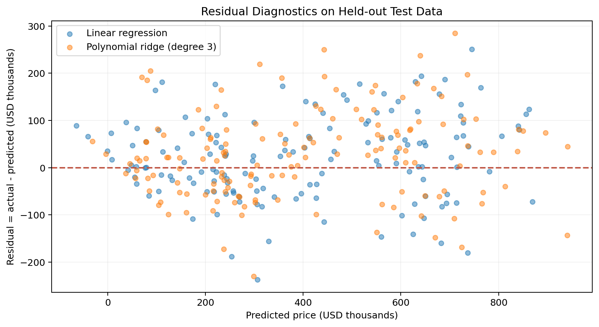

# Hi, I'm He Zhuoyan

**Aspiring Data Analyst | Data Science & Business Analytics | Data Visualization**

I have a background in accounting and business, and I am developing skills in data science and analytics. I enjoy turning complex data into clear, meaningful stories, investigating patterns, and exploring how models perform beyond their training datasets.

## About Me

My interests include predictive modeling, exploratory data analysis, data visualization, and the intersection of business questions and technical methods. I value reproducible analysis and transparent communication of model limitations.

## Technical Skills

| Area | Tools & Techniques |
| --- | --- |
| Programming | Python, SQL |
| Data analysis | Pandas, NumPy, exploratory data analysis |
| Machine learning | scikit-learn, linear regression, model evaluation |
| Visualization | Matplotlib, data storytelling |
| Other | Excel, GitHub, Jupyter Notebook |

## Featured Project

### House Price Prediction: Model Performance and Residual Diagnostics

**Research question:** How accurately can basic housing attributes predict house prices, and what can held-out prediction errors reveal about model limitations? Does a more complex polynomial ridge model generalize better than linear regression?

**Project status:**  Ongoing — reproducible demonstration with synthetic housing data.

*Figure 1. Actual vs. predicted prices on the held-out test set, using synthetic observations.*

The analysis compares a linear regression baseline with a degree-3 polynomial ridge regression model. On a held-out synthetic test set, linear regression achieved **R² = 0.885** and **MAE ≈ $71,992**, while polynomial ridge achieved **R² = 0.870** and **MAE ≈ $75,581**. The more complex model had higher training R² but lower test R², illustrating why training fit alone can be misleading.

*Figure 2. Residual diagnostics help reveal the patterns and variation in prediction errors.*

**Key limitation:** This project uses artificially generated data (600 synthetic homes), not actual housing transactions. Findings should not be generalized to a real-world housing market. Important real-world drivers such as neighborhood, school quality, and market timing are absent.

**[View the project repository on GitHub](https://github.com/ZorinaHo/data-science-project)**

## What's Next

- Explore model behavior across different price ranges.
- Investigate additional features and validation strategies.
- Replace synthetic data with an appropriately licensed real-world dataset if available.

---

*Thanks for visiting my portfolio!*
